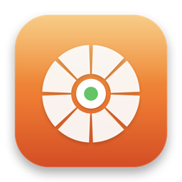

# Zestify 🍋 — Offline Radial File Converter for macOS
### The Ultimate Open-Source Tangerine for Mac Alternative | Drag & Drop Video, Audio, Image & Document Converter
### Быстрый офлайн-конвертер файлов для macOS с радиальным меню | Бесплатный аналог Tangerine для Mac

<p align="center">
  
</p>

<p align="center">
  <a href="https://github.com/TDDaniel-tg/converter"></a>
  <a href="https://github.com/TDDaniel-tg/converter"></a>
  <a href="https://github.com/TDDaniel-tg/converter"></a>
  <a href="https://github.com/TDDaniel-tg/converter"></a>
  <a href="https://github.com/TDDaniel-tg/converter/blob/main/LICENSE"></a>
  <a href="https://github.com/TDDaniel-tg/converter"></a>
</p>

<p align="center">
  <b>🌐 Language / Язык:</b>
  <a href="#-english"><b>English</b></a> •
  <a href="#-русский"><b>Русский</b></a>
</p>

---

## 🇬🇧 English

### 🌟 What is Zestify?

**Zestify** is an ultra-fast, lightweight, open-source macOS menu bar application designed as a **free and private alternative to Tangerine for Mac**. It revolutionizes how you convert files on macOS: simply drag any video, audio, image, or document in Finder, hold **`Shift`**, and drop it onto an elegant **Liquid Glass radial wheel** to convert it instantly.

All conversions are processed **100% locally on your Mac** using hardware acceleration and bundled static FFmpeg. No internet required, no cloud uploads, no monthly subscriptions, and zero tracking.

---

### ✨ Key Features

- 🍩 **Liquid Glass Radial Menu**: Ergonomic 6-segment frosted glass wheel rendered in native AppKit/CoreGraphics with dynamic specular highlights, glowing orange hover states, and a central format badge.
- 🎬 **Universal Video Converter**: Converts virtually any video format (including legacy **AVI, DivX, XviD**, MKV, WebM, MP4, MOV, and animated GIFs) powered by an embedded static FFmpeg binary.
- 🎵 **High-Fidelity Audio Converter**: Fast transcoding between MP3, M4A (AAC), FLAC (lossless), OGG, OPUS, AIFF, and WAV. Also extracts pristine audio from any video file with a single drop.
- 🖼 **Next-Gen Image Processing**: Convert PNG, JPEG, WebP, HEIC, TIFF, BMP, and vector PDFs with native CoreImage color preservation.
- 📁 **In-Place Output with Auto-Reveal**: Converted files are saved directly into the source directory with clean naming (`filename_converted.ext` or `filename.ext`), and instantly highlighted in Finder.
- ⏱ **Visual Progress HUD**: A non-intrusive floating frosted glass HUD displays conversion progress and alerts you with a native notification upon completion.
- 🛡 **Smart CAD & App Protection (Finder-Only)**: Automatically detects when you are working in 3D CAD software (like **Autodesk Fusion 360, Blender, FreeCAD**), IDEs, or games so pressing `Shift` never interrupts your workflow.
- ⚙️ **Anti-False-Positive Filter**: Built-in 300ms debounce delay and drag pasteboard detection ensure the wheel only appears when you intentionally want to convert.
- 🔕 **Permanent Permission Suppression**: Asks for Accessibility permissions only once on first run and never bothers you with alerts again.
- 🛠 **Quick Tools Wheel (`Option + Shift`)**: One-click ZIP archiving, 50% image resizing, EXIF metadata stripping, and QR code detection.

---

### 📊 Supported Formats Matrix

| Category | Input Formats | Radial Target Options |
|---|---|---|
| **Video** | `.avi`, `.mp4`, `.mov`, `.mkv`, `.webm`, `.flv`, `.wmv`, `.m4v`, `.ts`, `.3gp` | **MP4**, **MOV**, **MKV**, **WEBM**, **GIF**, **MP3** (Extract Audio) |
| **Audio** | `.wav`, `.mp3`, `.m4a`, `.flac`, `.ogg`, `.opus`, `.aiff`, `.aac`, `.wma` | **MP3**, **M4A**, **FLAC**, **OGG**, **OPUS**, **AIFF** |
| **Images** | `.png`, `.jpg`, `.jpeg`, `.webp`, `.heic`, `.heif`, `.tiff`, `.bmp`, `.svg` | **PNG**, **JPEG**, **WEBP**, **HEIC**, **PDF**, **GIF** |
| **Documents** | `.pdf` | **PNG**, **JPEG**, **TIFF** (Multi-page rendering) |
| **Quick Tools** | Any file or folder | **Compress (ZIP)**, **Resize 50%**, **Strip EXIF**, **QR Scan** |

---

### 🕹 How to Use

1. **Launch Zestify**: It lives quietly in your macOS menu bar (lemon icon 🍋).
2. **Convert via Drag & Drop**:
   - Select one or more files in **Finder**.
   - Start dragging them, then hold **`Shift`**.
   - The translucent Liquid Glass wheel appears right around your mouse cursor.
   - Hover over your target format (e.g. **MP4**) and release the mouse to drop.
3. **Convert via Finder Selection**:
   - Select files in Finder and press/hold **`Shift`** — the wheel opens immediately under your cursor.
4. **Access Quick Tools**:
   - Hold **`Option + Shift`** during drag to reveal utilities: Create ZIP archive, Resize images, or Strip metadata.
5. **Dismiss Anytime**:
   - Simply release `Shift` or press **`Esc`** to dismiss the radial wheel without action.

---

### 🚀 Installation & Building from Source

#### Prerequisites
- macOS 13.0 Ventura, macOS 14 Sonoma, or macOS 15 Sequoia
- Apple Silicon (M1/M2/M3/M4) or Intel processor
- Xcode 15+ or Swift 5.9+ Command Line Tools

#### Build & Run
```bash
# 1. Clone the repository
git clone https://github.com/TDDaniel-tg/converter.git
cd converter

# 2. Build the app using Swift Package Manager
swift build -c release

# 3. Or open and build in Xcode
open Package.swift
```

To run the pre-built `/Applications/Zestify.app`:
```bash
open /Applications/Zestify.app
```

---

### 🛡 Architecture & Technology Stack

- **Framework**: Native **Swift 5.9 + AppKit** (pure native macOS controls, zero Electron bloat, instantaneous launch).
- **UI Engine**: High-performance **CoreGraphics** and **CoreAnimation** layer composition with backdrop blur filter for authentic liquid glass aesthetics.
- **Conversion Core**:
  - Standalone bundled **FFmpeg 6.0** (arm64 static) for heavy video/audio codecs (AVI, DivX, XviD, MKV, FLAC, Opus).
  - Apple **AVFoundation** for native ProRes and H.264/HEVC hardware acceleration.
  - Apple **CoreImage** and **PDFKit** for sub-millisecond image transcoding and document rendering.
- **System Integration**:
  - `CGEventTap` & `NSEvent.addGlobalMonitorForEvents` for non-invasive modifier monitoring.
  - AppleScript-bridged Finder selection resolver for instant dragless conversion.

---

<br />

---

## 🇷🇺 Русский

### 🌟 Что такое Zestify?

**Zestify** — это быстрый, легковесный и полностью бесплатный конвертер файлов для macOS с открытым исходным кодом, созданный как **полноценный аналог популярного Tangerine for Mac**. Он кардинально меняет работу с файлами: больше не нужно открывать тяжелые программы или загружать личные документы на сомнительные сайты-конвертеры.

Просто зажмите файл в Finder, удерживайте **`Shift`**, и вокруг курсора появится стильное **радиальное меню "Liquid Glass" (жидкое стекло)**. Наведите курсор на нужный формат и отпустите — файл мгновенно конвертируется и сохранится прямо в ту же папку!

---

### ✨ Главные возможности

- 🍩 **Радиальное меню в стиле Liquid Glass**: Премиальный дизайн с эффектом матового стекла, плавными неоновыми откликами, оранжевой подсветкой активного сегмента и центральной плашкой формата.
- 🎬 **Всеядный видео-конвертер**: Конвертирует любые видео (включая **AVI, DivX, XviD**, MKV, WebM, MP4, MOV и анимированные GIF) благодаря встроенному независимому FFmpeg.
- 🎵 **Аудио-конвертер высокого качества**: Быстрая конвертация между MP3, M4A (AAC), FLAC (без потерь качества), OGG, OPUS, AIFF и WAV. Извлечение звуковой дорожки из любого видео в один клик.
- 🖼 **Конвертер изображений и фото**: Поддержка PNG, JPEG, WebP, HEIC (с iPhone), TIFF, BMP и многостраничных PDF.
- 📁 **Сохранение в исходную папку**: Сконвертированный файл появляется ровно там, где лежит оригинал, и сразу подсвечивается в Finder.
- ⏱ **Индикатор обработки (HUD)**: Аккуратное стеклянное всплывающее окно показывает статус конвертации, а по завершении присылает уведомление.
- 🛡 **Защита от случайных срабатываний и CAD-программ**: Zestify активируется **только в Finder**. При работе в **Autodesk Fusion 360, Blender**, графических редакторах, играх или IDE зажатый `Shift` не будет вызывать колесо и мешать работе.
- ⚙️ **Фильтр ложных нажатий**: Задержка 300мс (debounce) и проверка перетаскивания исключают случайные вызовы колеса.
- 🔕 **Никаких повторных запросов разрешений**: Доступ к Универсальному доступу (Accessibility) запрашивается один раз при первом запуске и больше никогда не беспокоит.
- 🛠 **Меню быстрых утилит (`Option + Shift`)**: Упаковка в ZIP-архив, уменьшение размера картинок на 50%, очистка метаданных EXIF/геолокации и сканер QR-кодов.
- 🔒 **100% Локально и Конфиденциально**: Работает полностью без интернета. Никаких подписок, рекламы, телеметрии и утечек данных.

---

### 📊 Таблица форматов

| Категория | Входные форматы | Варианты конвертации в колесе |
|---|---|---|
| **Видео** | `.avi`, `.mp4`, `.mov`, `.mkv`, `.webm`, `.flv`, `.wmv`, `.m4v`, `.ts`, `.3gp` | **MP4**, **MOV**, **MKV**, **WEBM**, **GIF**, **MP3** (извлечь звук) |
| **Аудио** | `.wav`, `.mp3`, `.m4a`, `.flac`, `.ogg`, `.opus`, `.aiff`, `.aac`, `.wma` | **MP3**, **M4A**, **FLAC**, **OGG**, **OPUS**, **AIFF** |
| **Фото/Изображения** | `.png`, `.jpg`, `.jpeg`, `.webp`, `.heic`, `.heif`, `.tiff`, `.bmp`, `.svg` | **PNG**, **JPEG**, **WEBP**, **HEIC**, **PDF**, **GIF** |
| **Документы** | `.pdf` | **PNG**, **JPEG**, **TIFF** |
| **Инструменты** | Любые файлы или папки | **Архив ZIP**, **Уменьшить 50%**, **Очистить EXIF**, **QR-сканер** |

---

### 🕹 Как пользоваться

1. **Запуск Zestify**: Приложение работает в строке меню (иконка лимончика 🍋).
2. **Конвертация перетаскиванием (Drag & Drop)**:
   - Выделите файлы в **Finder**.
   - Начните перетаскивать их и зажмите клавишу **`Shift`**.
   - Появится полупрозрачное стеклянное колесо с вариантами форматов.
   - Наведите мышь на нужный формат (например, **MP4**) и отпустите.
3. **Конвертация выделенных файлов**:
   - Выделите файл в Finder и удерживайте **`Shift`** — колесо появится прямо под курсором.
4. **Быстрые утилиты**:
   - Зажмите комбинацию **`Option + Shift`** для вызова утилит (сжатие в ZIP, удаление геотегов, ресайз).
5. **Отмена действия**:
   - Отпустите `Shift` или нажмите клавишу **`Esc`** — колесо моментально исчезнет.

---

### 🚀 Установка и сборка

#### Требования
- macOS 13.0 Ventura, macOS 14 Sonoma, macOS 15 Sequoia или новее
- Процессор Apple Silicon (M1/M2/M3/M4) или Intel Mac
- Установленный Xcode или Swift Command Line Tools

#### Сборка через терминал
```bash
# Клонирование репозитория
git clone https://github.com/TDDaniel-tg/converter.git
cd converter

# Сборка релизной версии
swift build -c release
```

Для запуска уже скомпилированного приложения:
```bash
open /Applications/Zestify.app
```

---

## 🔍 Search Keywords & SEO Meta / Теги для поиска

To help developers, Mac power-users, and creators discover this project:

- **English Keywords**:
  `tangerine for mac alternative`, `tangerine alternative open source`, `macos radial file converter`, `pie menu converter mac`, `macos drag drop converter`, `offline video converter macos`, `avi to mp4 converter mac`, `batch file converter macos`, `liquid glass mac app`, `drop to convert mac`, `swift appkit menu bar converter`, `free offline mac converter`, `heic to jpg mac converter`, `extract audio from video mac`.
- **Русские ключевые слова**:
  `конвертер файлов для mac`, `конвертер файлов macos`, `аналог tangerine для mac`, `tangerine альтернатива mac`, `бесплатный конвертер видео mac`, `конвертер avi в mp4 macos`, `конвертер через зажатие shift mac`, `радиальное меню конвертер`, `локальный конвертер без интернета mac`, `пакетный конвертер файлов macos`, `конвертер фото heic webp png mac`.

---

## 📄 License

Distributed under the **MIT License**. See [LICENSE](LICENSE) for more details.

---

<p align="center">
  Crafted with 🍋 by <a href="https://github.com/TDDaniel-tg"><b>TDDaniel-tg</b></a>
</p>
